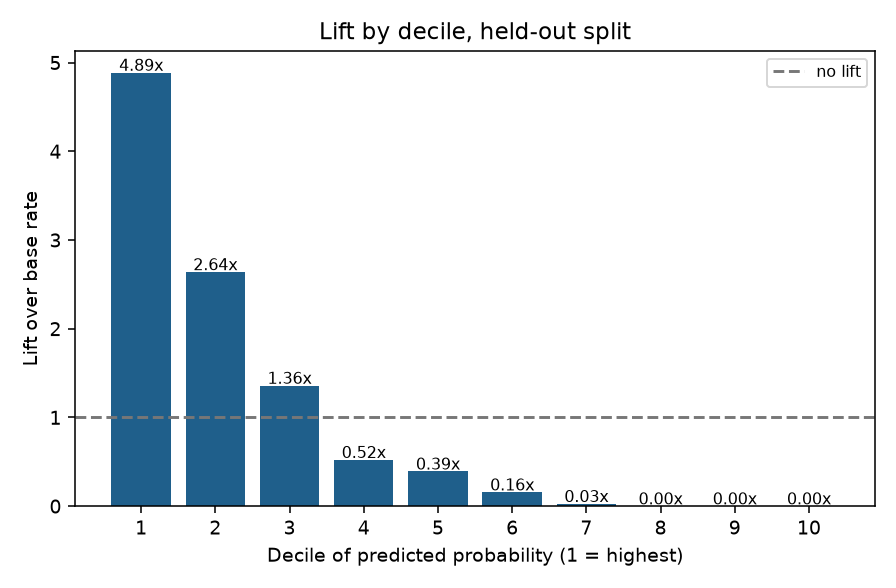
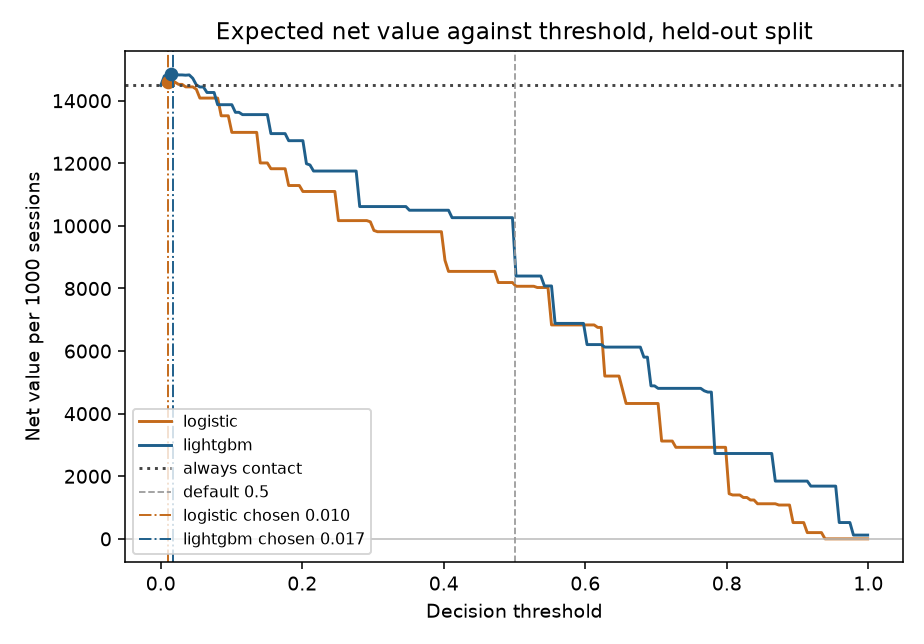
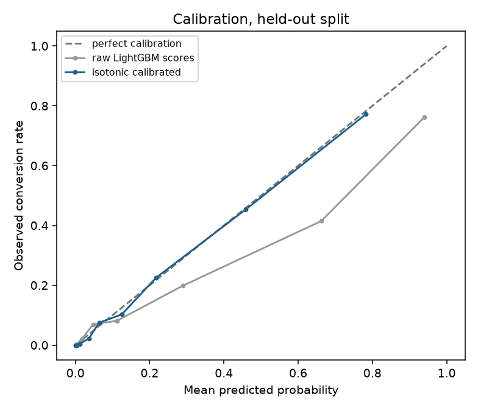
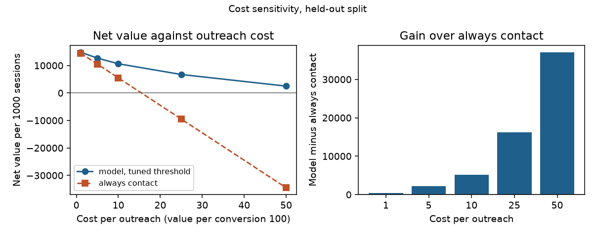
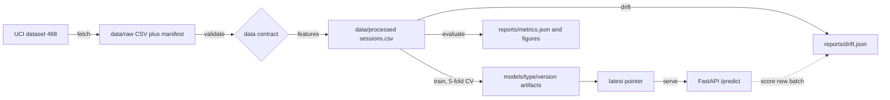

# Online Shopper Intention

Calibrated session-level purchase intention model on the UCI Online Shoppers Purchasing Intention dataset, with a value-based decision threshold, a versioned model registry and a FastAPI service.

## What this is

An end-to-end pipeline that turns a public e-commerce session table into a deployed conversion model. It downloads the raw data and pins its hash, checks a data contract, builds a deterministic feature table, trains a logistic regression baseline and a LightGBM model, calibrates both with isotonic regression, and picks the decision threshold that maximises expected net value rather than accuracy. The trained artifact carries its threshold, calibration and metrics, and the API reports the per-session probability, the decision, the expected value and the three strongest feature contributions.

## Why it was rebuilt

The original coursework notebook (`legacy/Shoppers_Predict.ipynb`, kept unmodified, Vietnamese comments) applied SMOTE to the whole dataset before the train/test split and fitted the scaler and one-hot encoder on all rows. That leaked synthetic and test information into training and into the test set, so its 0.926 accuracy and 0.949 recall for Random Forest are not comparable to any number below. This rebuild keeps the same dataset and models but moves preprocessing inside cross-validation, calibrates probabilities, selects the threshold on training folds only, and reports the held-out result once.

## Results

All numbers come from the run recorded in `reports/metrics.json` on 2,466 held-out sessions (382 conversions, 15.49 percent). Value is 100 per conversion and 1 per outreach, from `configs/base.yaml`.

### Held-out test split

| Model | Threshold | Precision | Recall | F1 | PR-AUC | ROC-AUC | Brier | KS at threshold | Net value per 1000 sessions |
|---|---|---|---|---|---|---|---|---|---|
| Always contact (no model) | 0.0000 | 0.1549 | 1.0000 | 0.2683 | n/a | n/a | n/a | n/a | 14,490.67 |
| Logistic regression (baseline) | 0.0101 | 0.1948 | 0.9948 | 0.3258 | 0.6246 | 0.8957 | 0.0821 | 0.2409 | 14,618.41 |
| LightGBM at default 0.5 | 0.5000 | 0.6573 | 0.6728 | 0.6649 | 0.7080 | 0.9264 | 0.0728 | 0.6085 | 10,263.18 |
| LightGBM, calibrated, business threshold | 0.0168 | 0.2406 | 1.0000 | 0.3878 | 0.7080 | 0.9264 | 0.0728 | 0.4213 | 14,846.72 |

The LightGBM threshold of 0.0168 was chosen on out-of-fold training probabilities. At that threshold it contacts 1,588 of 2,466 sessions (64.4 percent), captures all 382 conversions and adds 356.04 per 1000 sessions over contacting everyone. Against the 0.5 default it adds 4,583.54 per 1000 sessions. The baseline threshold was selected the same way, so the comparison is between two value-optimised policies, not between a tuned model and an untuned one.

Brier score on the held-out split improves from 0.0837 (raw LightGBM scores) to 0.0728 after isotonic calibration; for logistic regression it improves from 0.1240 to 0.0821. Permutation importance on the held-out split ranks `PageValues` first (ROC-AUC drop 0.0994), then `PageValuePerProductPage` (0.0455), `Month_May` (0.0219), `Month_Nov` (0.0170) and `Month_Mar` (0.0094).

### Cross-validated headline numbers

Stratified 5-fold cross-validation inside the training split (9,864 sessions), out-of-fold predictions, same thresholds.

| Model | PR-AUC | ROC-AUC | Brier | Precision | Recall | F1 | Net value per 1000 sessions |
|---|---|---|---|---|---|---|---|
| Logistic regression (baseline) | 0.6620 | 0.9061 | 0.0780 | 0.2005 | 0.9961 | 0.3338 | 14,641.12 |
| LightGBM, calibrated | 0.7333 | 0.9311 | 0.0688 | 0.2472 | 0.9967 | 0.3962 | 14,796.03 |

LightGBM beats the logistic baseline on PR-AUC (0.7333 against 0.6620) and ROC-AUC (0.9311 against 0.9061). The margin over always-contact is small because the default economics make blanket outreach profitable: at 100 value and 1 cost, any session with a probability above 0.01 is worth contacting, and the base rate is 0.155. The lift table shows where the model separates sessions; the value gap shows how little that separation is worth at this cost ratio.

### Decile lift, held-out split, LightGBM

Sessions sorted by calibrated probability, 10 equal bins, 1 is the highest-scoring bin.

| Decile | Sessions | Conversions | Response rate | Lift | Cumulative conversions captured |
|---|---|---|---|---|---|
| 1 | 247 | 187 | 0.7571 | 4.89x | 48.95% |
| 2 | 247 | 101 | 0.4089 | 2.64x | 75.39% |
| 3 | 247 | 52 | 0.2105 | 1.36x | 89.01% |
| 4 | 247 | 20 | 0.0810 | 0.52x | 94.24% |
| 5 | 247 | 15 | 0.0607 | 0.39x | 98.17% |
| 6 | 247 | 6 | 0.0243 | 0.16x | 99.74% |
| 7 | 246 | 1 | 0.0041 | 0.03x | 100.00% |
| 8 | 246 | 0 | 0.0000 | 0.00x | 100.00% |
| 9 | 246 | 0 | 0.0000 | 0.00x | 100.00% |
| 10 | 246 | 0 | 0.0000 | 0.00x | 100.00% |

The top three deciles contain 89 percent of conversions and 30 percent of sessions. The table is also written to `reports/decile_lift.csv`.



### Policy comparison, held-out split, LightGBM

| Policy | Sessions contacted | Conversions captured | Net value | Net value per 1000 sessions | Gap vs chosen |
|---|---|---|---|---|---|
| Always contact | 2,466 | 382 | 35,734.00 | 14,490.67 | -356.04 |
| Default 0.5 | 391 | 257 | 25,309.00 | 10,263.18 | -4,583.54 |
| Chosen 0.0168 | 1,588 | 382 | 36,612.00 | 14,846.72 | 0.00 |



Calibration is checked on the same split: raw tree scores are under-confident at low probabilities and over-confident above roughly 0.2, and the isotonic mapping pulls them back to the diagonal.



The precision-recall curve and the permutation importance ranking are in `reports/figures/pr_curve.png` and `reports/figures/permutation_importance.png`.

### Cost sensitivity

Cost per outreach is swept from 1 to 50 with value per conversion fixed at 100. For each cost the threshold is chosen on the training out-of-fold probabilities, then applied once to the held-out split. Nothing is chosen on test.

| Cost per outreach | Threshold | Contact rate | Precision | Recall | Net value per 1000, model | Net value per 1000, always contact | Delta |
|---|---|---|---|---|---|---|---|
| 1 | 0.0168 | 0.6440 | 0.2406 | 1.0000 | 14,846.72 | 14,490.67 | +356.04 |
| 5 | 0.0542 | 0.4562 | 0.3280 | 0.9660 | 12,682.48 | 10,490.67 | +2,191.81 |
| 10 | 0.1017 | 0.3609 | 0.3944 | 0.9188 | 10,624.49 | 5,490.67 | +5,133.82 |
| 25 | 0.2780 | 0.2097 | 0.5706 | 0.7723 | 6,721.41 | -9,509.33 | +16,230.74 |
| 50 | 0.5013 | 0.1586 | 0.6573 | 0.6728 | 2,493.92 | -34,509.33 | +37,003.24 |

At the default cost of 1 the model adds 356.04 per 1000 sessions over contacting everyone, which is 2.5 percent of the blanket policy's value. The advantage grows as outreach gets more expensive: 2,191.81 at cost 5 (21 percent), 5,133.82 at cost 10, 16,230.74 at cost 25 and 37,003.24 at cost 50. Always-contact breaks even at 15.49 per outreach, the base rate 0.1549 times the value 100; above that it destroys value on every session, while the tuned policy still earns 2,493.92 per 1000 at cost 50. The model's own net value falls from 14,846.72 to 2,493.92 per 1000 across the sweep, so the table shows where targeting pays, not that the model gets better.

At cost 50 the chosen threshold is 0.5013, which reproduces the default 0.5 policy (391 contacts, precision 0.6573, recall 0.6728). That is a consistency check on the sweep, not a tuned result. The model does not lose to always-contact at any of the five costs, but at the default cost it barely wins.



Source: `reports/cost_sensitivity.csv`, also embedded in `reports/metrics.json` under `cost_sensitivity`. Regenerate with `python -m shopper_intent sensitivity`.

## Quickstart

```bash
python -m pip install -e ".[dev]"
python -m shopper_intent fetch
python -m shopper_intent validate && python -m shopper_intent features
python -m shopper_intent train && python -m shopper_intent evaluate
python -m shopper_intent serve
```

The service listens on `http://127.0.0.1:8125`. `make install`, `make fetch`, `make train` and the other targets wrap the same commands. `python -m shopper_intent drift` and `python -m shopper_intent drift --current path/to/new_sessions.csv` write `reports/drift.json`. `python -m shopper_intent sensitivity` writes `reports/cost_sensitivity.csv` and `reports/figures/cost_sensitivity.png`; `--costs 1,5,10` overrides the swept costs and `--model logistic` analyses the baseline.

## Data

Source: [UCI Machine Learning Repository, dataset 468](https://archive.ics.uci.edu/dataset/468/online+shoppers+purchasing+intention+dataset), file `https://archive.ics.uci.edu/static/public/468/data.csv` (fallback `https://archive.ics.uci.edu/ml/machine-learning-databases/00468/online_shoppers_intention.csv`).

| Property | Value |
|---|---|
| Rows | 12,330 |
| Columns | 17 features plus `Revenue` |
| Positive rate | 0.1547 |
| Duplicate rows | 125 (1.01 percent), kept as published |
| SHA256 | `b3055ee355f59134d851d32641183cb4a8b45def7124d2f50442a042f358e0d9` |
| Fetched at | 2026-10-31T11:58:45+00:00 |
| Licence | CC BY 4.0 |
| Raw file | `data/raw/online_shoppers_intention.csv` plus `data/raw/manifest.json` |

The repository contains no copy of the dataset. `fetch` writes the payload untouched, records source URL, fetch time, SHA256, row count and the first and last observation in `data/raw/manifest.json`, and is a no-op when the cached file still matches that manifest. Set `data.expected_sha256` in the config to fail loudly if the upstream file changes. Data and model artifacts are gitignored and rebuilt from these commands.

Citation: Sakar, C.O., Polat, S.O., Katircioglu, M., Kastro, Y. (2019). Real-time prediction of online shoppers' purchasing intention using multilayer perceptron and LSTM recurrent neural networks. Neural Computing and Applications, 31, 6893-6908.

## Architecture



Package layout: `shopper_intent.data` (fetch, validate), `shopper_intent.features` (build), `shopper_intent.models` (train, evaluate, registry, metrics, artifact), `shopper_intent.serving` (FastAPI), `shopper_intent.monitor` (PSI drift). Every command is also a function that tests call directly.

## Model card

The full model card is in [`docs/model_card.md`](docs/model_card.md).

| Item | Value |
|---|---|
| Model | LightGBM with isotonic calibration, logistic regression baseline |
| Task | Binary classification of a session ending in a purchase |
| Input | 17 raw session features, 32 columns after ratio features and one-hot encoding |
| Output | Calibrated probability, contact or skip decision, expected value, top-3 contributions |
| Decision threshold | 0.0168, chosen on out-of-fold training probabilities by expected net value |
| Headline held-out metrics | PR-AUC 0.7080, ROC-AUC 0.9264, Brier 0.0728, recall 1.0000 at the threshold |
| Intended use | Prioritising outreach and analysing which session features drive conversion |
| Not for | Individual credit, pricing or eligibility decisions; any use where a false negative is a legal or safety issue |

## Monitoring

`python -m shopper_intent drift` computes the population stability index for all 32 model columns against the training split and writes `reports/drift.json`. PSI below 0.10 is stable, 0.10 to 0.25 is moderate, 0.25 and above is significant. By default the current distribution is the held-out split, which is a sanity check and currently shows a maximum PSI of 0.0060 (`ProductRelated`); pass `--current` with a raw CSV of new sessions for a real batch.

The drift check covers input distribution only. It does not measure performance, because labels arrive late or never; a production setup should join conversion outcomes back to scored sessions and track PR-AUC, calibration and net value on a delay, and alert when the contact rate at the fixed threshold moves outside its expected band.

## Limitations

- The original notebook reported 0.926 accuracy and 0.949 recall after SMOTE was applied before the split and preprocessing was fitted on all rows. Those numbers are inflated by leakage and are not comparable with the numbers here.
- Accuracy at the chosen threshold is 0.51 for LightGBM. That is expected: the value-optimal policy accepts many false positives because outreach is cheap relative to a conversion. Accuracy is a poor summary here and is reported for completeness only.
- The default economics (value 100, cost 1) make always-contact profitable. The model's measured advantage over contacting everyone is 356.04 per 1000 sessions on the test split and 325.63 in cross-validation (14,796.03 against 14,470.40). It is real but small. With a higher cost per outreach the threshold rises and the gap widens; the sweep in the cost sensitivity table covers costs from 1 to 50, and both values are configurable.
- The threshold is tuned to one cost ratio. Changing `value_per_conversion` or `cost_per_outreach` requires retraining the threshold selection; the API reports the stored threshold so a mismatch is visible.
- One held-out split of 2,466 sessions. Test metrics move by a few points between splits; the cross-validated numbers are the more stable estimate.
- Isotonic calibration is fitted on out-of-fold predictions from models trained on 4/5 of the training split and applied to a model refitted on all of it. The held-out split is used to check calibration quality, not to fit it.
- The data has no customer identifier and no timestamps, so the split is random and stratified rather than temporal. A production model should be validated on later sessions than it was trained on.
- 125 exact duplicate rows are kept. A random split can place copies in both train and test, which slightly favours the test scores; the effect is limited to about 1 percent of rows.
- `OperatingSystems`, `Browser`, `Region` and `TrafficType` are integer codes treated as numeric. Tree models split them without assuming order, but the logistic baseline treats them as ordinal, which is a modelling compromise.
- The one-hot vocabulary is fixed at training time. The API rejects `Month`, `VisitorType` or `Weekend` values outside it instead of silently producing an all-zero row.
- Net value is an assumption about margin per conversion, not measured incremental revenue. There was no experiment and no control group.
- Feature contributions are additive tree SHAP values for the model output, not causal effects. A large `PageValues` contribution means the model used that feature, not that changing it would change behaviour.

## Project layout

```
README.md
LICENSE
pyproject.toml
Makefile
Dockerfile
.dockerignore
.gitignore
.pre-commit-config.yaml
.github/workflows/ci.yml
configs/base.yaml
src/shopper_intent/
  __init__.py  __main__.py  cli.py  config.py
  data/        fetch.py  validate.py
  features/    build.py
  models/      model.py  metrics.py  train.py  evaluate.py  registry.py
               sensitivity.py
  serving/     app.py
  monitor/     drift.py
tests/
  conftest.py  test_config.py  test_fetch.py  test_validate.py
  test_features.py  test_train.py  test_drift.py  test_sensitivity.py
  test_api.py
docs/model_card.md
legacy/Shoppers_Predict.ipynb
data/raw/.gitkeep  data/processed/.gitkeep
reports/.gitkeep  reports/figures/.gitkeep
```

Gitignored and rebuilt by the commands above: `data/raw/*`, `data/processed/*`, `models/*`. `reports/metrics.json`, `reports/drift.json`, `reports/decile_lift.csv`, `reports/cost_sensitivity.csv` and the figures are kept in the repository from the run above so the numbers can be inspected without retraining.

## License

MIT, copyright Hoang Hieu Nguyen. The dataset keeps its own CC BY 4.0 licence.
